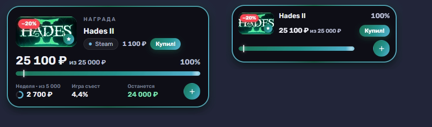
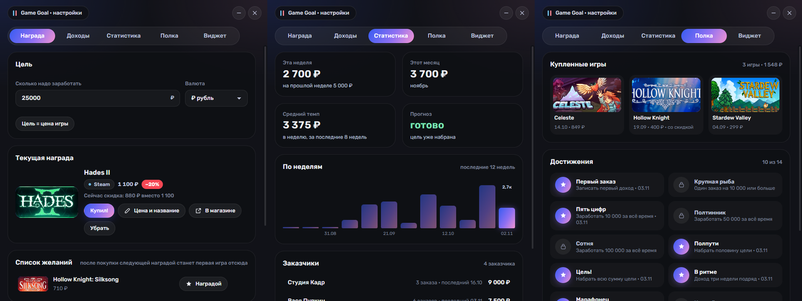
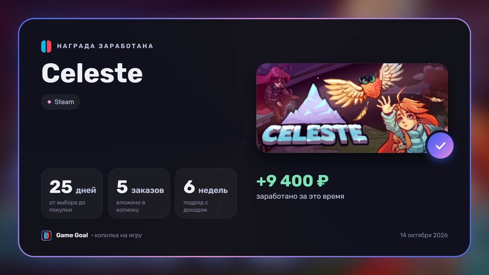

# Game Goal

Виджет на рабочий стол: копилка заработка с игрой-наградой. Записываешь, сколько заработал, и видишь,
сколько осталось до цели и какую часть заработанного «съест» игра. Стиль — интерфейсы Nintendo:
стеклянная карточка, переливающаяся обводка, Joy-Con, когда цель достигнута.

Один файл на 6,5 МБ, без установки.


## Что умеет

- **Цель и прогресс.** Заработано из нужной суммы, сколько осталось, прогноз «≈5 нед» по твоему темпу.
- **Игра-награда.** Поиск по Steam и европейскому Nintendo eShop: обложка, полное название и цена подтягиваются сами,
  картинки на диск не сохраняются. Цены в евро переводятся в рубли по курсу ЦБ.
- **«Купил!».** Спрашивает, сколько заплатил (цифровая версия, картридж, скидка), вычитает сумму из копилки и ставит
  игру на полку. Следующей наградой становится первая игра из списка желаний.
- **Скидки.** Раз в 12 часов проверяет цены награды и списка желаний и присылает уведомление Windows о скидке.
- **Быстрый ввод.** `1500 превью @Вася` — сумма, заметка и заказчик одной строкой. Из любой программы — **Ctrl+Alt+G**.
- **Статистика.** Доход по неделям, темп, заказчики и кто давно не писал.
- **Цель на неделю.** Кольцо на виджете и баннер, когда она набрана. В понедельник — уведомление с итогами недели.
- **Цвета из обложки.** Обводка и полоса виджета перекрашиваются в цвета игры-награды.
- **Компактный вид.** Только обложка, сумма и полоса — переключается из меню в трее.
- **Полка и 14 достижений.**
- **Резервные копии.** Раз в день, последние 10; повреждённый файл данных восстанавливается сам.
- **Карточка «Награда заработана».** После покупки — картинка для Discord или Telegram: обложка, сколько дней
  копил, сколько заказов вложил и, если хочешь, сколько заработал за это время. Копируется в буфер одной кнопкой.







## Установка

Нужна Windows 10/11. Установщика нет.

1. Скачай `GameGoal.exe` со страницы [последней версии](https://github.com/ShuraProgerMain/game-goal/releases/latest).
2. Положи его в любую папку и запусти.

Файл не подписан, поэтому при первом запуске Windows может показать «Система Windows защитила ваш компьютер»:
«Подробнее» → «Выполнить в любом случае».

Программа сама добавит себя в «Пуск», команду `gg` в терминал и автозапуск — всё указывает на то место, где лежит
файл. Перенёс файл в другую папку — после запуска всё обновится. Каждое из этого выключается в настройках:
вкладка «Виджет» → «В системе».

- **Обновить:** закрыть программу, заменить `GameGoal.exe`, запустить.
- **Удалить:** «Виджет» → «В системе» → «Убрать из системы», потом удалить файл. Данные остаются.

Версии для macOS и Linux собираются из того же кода, но пока не проверены.

## Как пользоваться

- Виджет двигается за любое пустое место; двойной клик — настройки, правый клик — меню.
- Значок в трее показывает и прячет виджет.
- В терминале:

```bash
gg add 1500 превью @Вася
```

`gg` — показать виджет, `gg stats` — статистика, `gg settings` — настройки.

Данные хранятся в `%APPDATA%\game-goal`: `data.json` и папка `backups`.

## Разработка

Программа на [Tauri 2](https://tauri.app): интерфейс — HTML и CSS, системная часть — Rust. Нужны Node.js, Rust
и на Windows — компилятор C++ из Visual Studio.

```bash
npm install
npm run dev     # запуск с перезагрузкой
npm run build   # src-tauri/target/release/GameGoal.exe
```

- `widget.html`, `settings.html`, `common.*`, `logic.js`, `card.js` — интерфейс и общая логика.
- `shim/core.js` — ядро: данные, достижения, скидки, трей, горячая клавиша. Работает в окне виджета,
  окно настроек обращается к нему через `shim/bridge.js`.
- `src-tauri/` — Rust: один экземпляр, плагины, файлы в папке данных, ярлык и команда `gg`.
- `sync-web.mjs` собирает из этого папку `web`, которую Tauri встраивает в exe.

`GAME_GOAL_PROFILE=<папка>` запускает программу с отдельной папкой данных и отдельным экземпляром: настоящие данные
и система не трогаются.

## Лицензия

[MIT](LICENSE)
