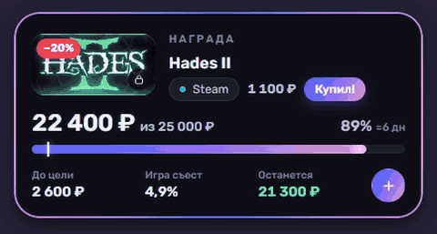

# Game Goal

Виджет на рабочий стол Windows: копилка заработка с игрой-наградой. Записываешь, сколько заработал, и видишь,
сколько осталось до цели и какую часть заработанного «съест» игра. Стиль — интерфейсы Nintendo:
стеклянная карточка, переливающаяся обводка, Joy-Con, когда цель достигнута.



## Что умеет

- **Цель и прогресс.** Заработано из нужной суммы, сколько осталось, прогноз «≈5 нед» по твоему темпу.
- **Игра-награда.** Поиск по Steam и европейскому Nintendo eShop: обложка, полное название и цена подтягиваются сами,
  картинки на диск не сохраняются. Цены в евро переводятся в рубли по курсу ЦБ.
- **«Купил!».** Спрашивает, сколько заплатил (цифровая версия, картридж, скидка), вычитает сумму из копилки и ставит
  игру на полку. Следующей наградой становится первая игра из списка желаний.
- **Скидки.** Раз в 12 часов проверяет цены награды и списка желаний и присылает уведомление Windows о скидке.
- **Быстрый ввод.** `1500 превью @Вася` — сумма, заметка и заказчик одной строкой. Из любой программы — **Ctrl+Alt+G**.
- **Статистика.** Доход по неделям, темп, заказчики и кто давно не писал.
- **Полка и 14 достижений.**
- **Резервные копии.** Раз в день, последние 10; повреждённый файл данных восстанавливается сам.

## Установка

Нужна Windows 10/11. Права администратора не нужны.

1. Скачай репозиторий (Code → Download ZIP) и распакуй, куда удобно.
2. Запусти `install.cmd`.

Установщик сам скачает Electron, добавит программу в «Пуск», команду `gg` в терминал и автозапуск.
Удалить: «Установка и удаление программ» или `install.cmd -Uninstall`. Данные при удалении остаются.

## Как пользоваться

- Виджет двигается за любое пустое место; двойной клик — настройки, правый клик — меню.
- Значок в трее показывает и прячет виджет.
- В терминале:

```bash
gg add 1500 превью @Вася
```

`gg` — показать виджет, `gg stats` — статистика, `gg settings` — настройки.

Данные хранятся в `%APPDATA%\game-goal`: `data.json` и папка `backups`.

## Разработка

```bash
npm install
npx electron .
```

`GAME_GOAL_PROFILE=<папка>` запускает программу с отдельной папкой данных, настоящие данные не трогаются.
